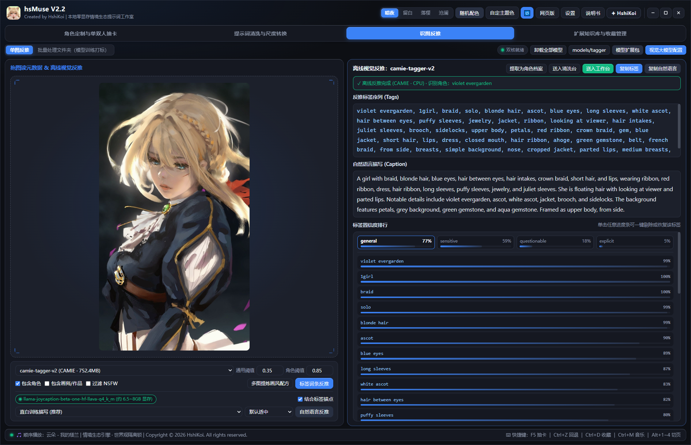
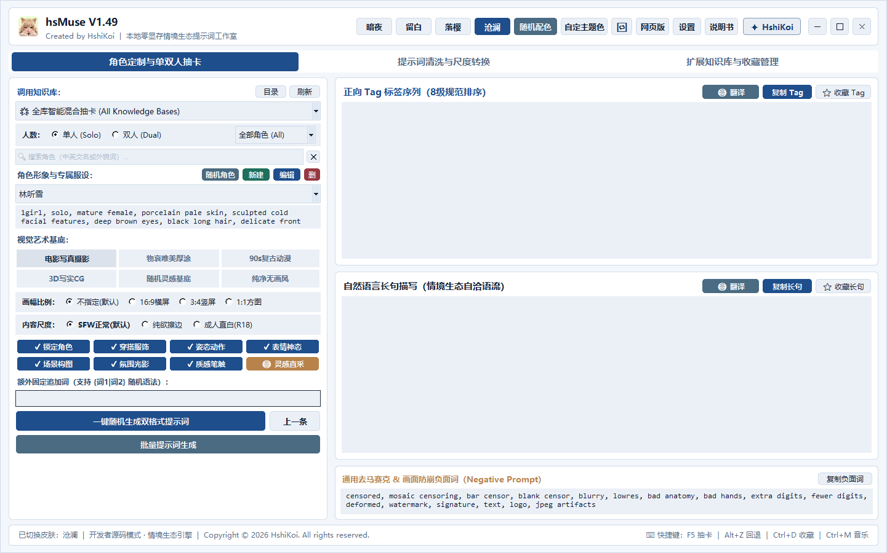

<!-- ==================== 置顶：内测微信群 START（不需要时整段删除即可） ==================== -->

  <table>
    <tr>
      <td align="center" width="140">
        
      </td>
      <td align="left" width="460">
        <strong>💬 加入 hsMuse 内测交流群（微信）</strong>  
- 抢先体验最新内测版本与新功能预告 
- Bug 优先反馈、模型配置答疑与提示词/词库分享 
- 微信扫码直接入群（若二维码过期，可添加微信号 <code>hshi2026</code> 备注 <code>hsMuse</code> 拉群）
      </td>
    </tr>
  </table>

<!-- ==================== 置顶：内测微信群 END ==================== -->

<h1>
  &nbsp;hsMuse
</h1>

**本地模块化 AI 绘画提示词工作室 & 离线识图与训练集批量打标工作台**  
**Local Visual Prompt Studio & Offline Dataset Captioning Workbench**

[简体中文](#-简体中文) • [English](#-english) • [📥 下载最新版 / Download](https://github.com/hshiKoi/hsMuse/releases/latest) • [🤗 视觉模型库 / Models](https://huggingface.co/hshiKoi/hsMuse-models) • [📋 更新日志 / Changelog](CHANGELOG.md) • [⚖️ 使用条款 / Terms](TERMS.md)

> [!IMPORTANT]
> **最新版本 V2.3 已发布（响应海外用户 @KieranW 反馈 · 五种语言全补齐 & 底层稳定性升级）：** 在 V2.x 跨代重构（双核离线识图反推、AI 训练集批量打标体检与流式无损音乐引擎）基础上，**V2.3** 全面补齐所有二级弹窗、批量进度与动态提示的五种语言覆盖，同步强化本地视觉模型上下文与重试稳定、WebP 元数据解析、大文件断点续传完整度校验与纯内存前端封装。欢迎通过 [GitHub Issues](https://github.com/hshiKoi/hsMuse/issues) 随时反馈。
>
> **下载建议：** 优先下载安装向导版 **`hsMuse_*_Setup.exe`**（`--onedir` 低误报目录架构，冷启动更快，覆盖升级与卸载永久保留 6 大用户目录及外置模型）；`hsMuse_*.exe` 仅作绿色便携备用。主程序保持**零内置模型轻量化**，所有功能完全公开。
>
> **首次安装提示：** 因个人独立开发暂未购买商业代码签名证书，Windows 首次运行若弹出「Windows 已保护你的电脑」蓝窗，点击 **「更多信息」→「仍要运行」** 即可（软件纯本机运行、零广告零捆绑，此为未签名独立软件的常见系统提示，请放心使用）。
>
> ---
>
> **Latest Release V2.3 (Responding to @KieranW's Feedback · Full 5-Language Parity & Core Stability Upgrades):** Building on the V2.x overhaul (dual-core offline image tagging, dataset batch captioning, and native lossless streaming BGM), **V2.3** completes 5-language coverage across every dialog and dynamic status, expands local Vision LLM context to 4096 with batch retry, strengthens WebP EXIF reading and resumable model downloads, and serves web assets directly from memory. Download **`hsMuse_*_Setup.exe`** first for faster startup, fewer antivirus false positives, and 100% preservation of local data & models on upgrade (`hsMuse_*.exe` is for portable single-file use only).
>
> **First-Run Note:** As an unsigned indie release without a commercial code-signing certificate, Windows SmartScreen may show *"Windows protected your PC"* on first launch—simply click **"More info" → "Run anyway"** (100% local and clean with zero bundled software; this is a standard prompt for unsigned indie apps).

## 🖼️ 界面预览 / Interface Preview

  4 套常驻皮肤 0ms 瞬切 · 支持 12 套随机灵感配色与自定义主题色（点击图片可查看大图） 4 Built-in Skins with Instant Switching · 12 Random Palettes & Custom Theme Colors (Click to zoom)

<table>
  <tr>
    <td align="center" width="50%">
      
       
      <b>暗夜 · Night</b>
    </td>
    <td align="center" width="50%">
      
       
      <b>留白 · Pure</b>
    </td>
  </tr>
  <tr>
    <td align="center" width="50%">
      
       
      <b>落樱 · Sakura</b>
    </td>
    <td align="center" width="50%">
      
       
      <b>沧澜 · Cobalt</b>
    </td>
  </tr>
</table>

---

## 🇨🇳 简体中文

### 简介
**hsMuse** 是一款面向 AI 绘画创作者与模型训练师的本地模块化工作台，全面适配主流标签系与自然语言绘画工作流及 LoRA / 微调模型训练。采用全新 **「一核双端」** 架构，桌面客户端与本地浏览器网页版共享同一套实时界面与数据，支持严格唯一窗口互斥，并针对 **1K / 2K / 4K / 8K** 全分辨率提供护眼弹性排版。

### 核心主打功能
- **🎯 双核离线识图反推（零内置模型轻量化架构）**
  - **0ms 全链路原图元数据秒读**：拖入、点选或 `Ctrl+V` 粘贴 PNG / WebP / JPEG 图片，0ms 秒读 SD WebUI / ComfyUI / NovelAI 内嵌正负面提示词与采样参数，深度兼容复杂连线拼接节点、WebP EXIF 偏移解析与工作流兜底读取。
  - **本地 ONNX 标签词条反推**：外置 `models/tagger/`，自动嗅探 GPU 加速并零显存回退 CPU；提供 4 档评级分布、可单击剔除/恢复的条形置信度排行、一键提取为角色档案、送入清洗台及 2~5 张参考图提炼共性画风配方。
  - **可选自然语言视觉大模型（本地 GGUF / 视觉 API）**：主程序保持轻盈不捆绑大模型权重；可选在软件内通过官方 **[HuggingFace 模型库](https://huggingface.co/hshiKoi/hsMuse-models)**（支持官方源与国内 HF-Mirror 断点续传及完整度校验）或 **[国内夸克网盘](https://pan.quark.cn/s/c141e7abfce0)** 获取 `models/vlm/` 扩展包（建议 6.5~8GB 空闲显存），无独显亦可直连本地推理服务或云端视觉 API。支持 **4 种描写风格 + 5 档输出篇幅 + 固定前后缀 + 标签锚点联合反推**，卸载瞬间 100% 清空显存。
- **🗂️ AI 模型训练集批量打标 & 数据体检工作台**
  - 支持递归扫描子目录、独立输出路径、4 种冲突模式（断点续跑跳过 / 覆盖 / 追加 / 前置）、触发词前置、角色 LoRA 外貌剥离、颜文字豁免下划线转换、括号转义、批量参数自动记忆、单图异常自动重试及完成后自动卸载模型。
  - 同步支持 **标准标签序列 `.txt`** 与 **英文自然语言 `.txt`** 双轨落盘，广泛适配各类标签系与自然语言大模型训练。
  - 内置 **全库词频体检**（点击 `🔍` 反查对应图片、一键筛未标、`Shift` 多选子集改标）、**图文逐张微调（`Ctrl+S` + 一键双语翻译核对）**，以及零体积 **数据体检三件套**（坏图/低分辨率/透明通道体检、透明底一键铺白/浅灰底、两阶段安全原子配对重命名与异常自动回滚）。
- **🧬 双轨角色库 · 世界观隔离 · 纯净美学基调与通用语法方言**
  - 内置 **81 位双轨角色**（含原创角色「林听雪」，旧版存档无损继承），同时具备标准角色词条与自然语言外貌描述；关闭「穿搭服饰」即精准锁定角色原版官服轮换。
  - 四大世界观隔离锁（现代 / 东方仙侠 / 物哀哥特 / 水畔汤泉）+ 室内外空间锁 + 6 套纯净美学基调 + 3 种输出语法方言（`标准标签` / `NovelAI` / `自然语言`）+ **词条文本 ↔ 权重编排** 双向切换、历史快照与本地/自定义 AI 润色。
- **✨ 极简画廊交互 · 流式无损音乐 · 数据中心与全生态便利**
  - **丝滑零负担交互**：4 套常驻皮肤（`暗夜` / `留白` / `落樱` / `沧澜`）0ms 瞬切 + 12 套随机灵感配色 + 自定义主题色；全站物理弹簧滑动胶囊、`暗夜 ↔ 留白` 顶栏昼夜掠影、识图顶栏「双核就绪」LED 胶囊。
  - **HTML5 原生流式背景音乐**：零后台线程、无体积限制，通吃 `.mp3 / .wav / .flac / .m4a / .aac / .ogg / .opus` 及大体积无损音轨，支持四态切换（`🔁/🔀/🔂/🔇`）、长按 0.5 秒切歌与双端防重音。
  - **清洗、翻译与云同步**：200 行批量清洗与权重剥离（完整覆盖 `()` / `[]` / `{}`）、独立 4 引擎双语对照翻译弹窗（Youdao / MyMemory / Google / 自定义 AI）、对称双栏 **云同步与数据中心**（GitHub Private Gist 加密漫游，支持 2000 角色 / 80 词库 / 2000 收藏 / 200 配方）及 **五种语言** 双端全同步。

### 快速开始与快捷键
1. 前往 [**Releases 页面**](https://github.com/hshiKoi/hsMuse/releases/latest) 下载最新版安装向导（`hsMuse_*_Setup.exe`）双击安装（免管理员权限，支持自由选盘，覆盖升级 100% 保留个人数据与 `models/`）。
2. 如需离线识图反推：在软件内打开 **「识图反推」** → **「模型扩展包」** 或 **「视觉大模型配置」** 一键下载，或前往 **[HuggingFace 模型库](https://huggingface.co/hshiKoi/hsMuse-models)** / **[国内夸克网盘](https://pan.quark.cn/s/c141e7abfce0)** 获取模型包放入对应 `models/` 目录即可。
3. 常用快捷键：`F5` 抽卡 ｜ `Ctrl + Z` 智能回退 ｜ `Ctrl + D` 收藏 Tag ｜ `Ctrl + M` 切换音乐 ｜ `Alt + 1~4` 极速切页 ｜ `Ctrl + V` 贴图识图 ｜ `Ctrl + S` 保存训练标注；双击空白区或右键托盘一键恢复默认窗口尺寸。
4. 想用 AI 扩展自定义词库或角色？请查看 [`templates/`](templates/) 目录中的范例与指令。

### 支持与交流
- **HuggingFace 模型仓库**：[huggingface.co/hshiKoi/hsMuse-models](https://huggingface.co/hshiKoi/hsMuse-models)
- **Patreon**：[patreon.com/c/hshiKoi](https://www.patreon.com/c/hshiKoi)
- **Ko-fi**：[ko-fi.com/hshikoi](https://ko-fi.com/hshikoi)
- **Civitai**：[civitai.red/user/HshiKoi](https://civitai.red/user/HshiKoi)
- **社群交流**：QQ 群 `978336169` ｜ 微信群 `hshi2026` ｜ 公众号 `画不出明天`
- **问题反馈**：欢迎直接提交 [GitHub Issues](https://github.com/hshiKoi/hsMuse/issues)

---

## 🌐 English

### Overview
**hsMuse** is a local modular visual prompt studio and offline dataset captioning workbench designed for AI artists and LoRA / fine-tuning model trainers. Built on a unified **Desktop + Local WebUI** architecture with strict single-window exclusivity and responsive eye-care typography for **1K / 2K / 4K / 8K** displays, it unifies coherent prompt engineering with professional offline image tagging and dataset management.

### Flagship Features
- **🎯 Dual-Core Offline Image Tagger (Zero-Bloat External Architecture)**
  - **0ms Full-Chain Metadata Reader**: Drag, select, or `Ctrl+V` PNG / WebP / JPEG images to read embedded SD WebUI / ComfyUI / NovelAI parameters in 0ms—including complex linked string-join node graphs, WebP EXIF decoding, and workflow fallbacks.
  - **Local ONNX Tag Extraction**: External `models/tagger/` models with automatic GPU acceleration and zero-VRAM CPU fallback. Features 4-tier rating distribution, clickable confidence ranking bars, one-click Character Profile extraction, and multi-image Style Recipe distillation.
  - **Optional Vision LLM Captioning (Local GGUF / Vision API)**: Keep the installer lightweight—optionally download external GGUF packs directly in-app from **[HuggingFace (`hshiKoi/hsMuse-models`)](https://huggingface.co/hshiKoi/hsMuse-models)** with resumable integrity-checked downloads (~6.5–8 GB available VRAM recommended), or connect any OpenAI-compatible Vision API with zero local VRAM. Supports **4 styles, 5 length presets, hard prefix/suffix wrapping, tag-anchor guidance**, and instant 100% VRAM release on unload.
- **🗂️ Dataset Batch Captioning & Audit Studio**
  - Recursive folder scanning, custom output directory, 4 conflict modes (Ignore/Resume, Overwrite, Append, Prepend), trigger words, character-LoRA appearance stripping, kaomoji-safe underscore replacement, bracket escaping, persistent preferences, automatic per-image retry, and auto-unload after completion.
  - Dual-format `.txt` export (**Standard Tags** or **Natural Language**) compatible with both tag-based and natural-language image models.
  - Includes **Dataset Tag Frequency Audit** (`🔍` filter images by tag, filter untagged, `Shift` multi-select subset editing), **Side-by-Side Image Review (`Ctrl+S` + instant bilingual translation)**, and a zero-dependency **Dataset Toolkit** (corrupt/low-res/alpha inspection, one-click transparent PNG flattening, and 2-phase atomic pair renaming with rollback protection).
- **🧬 Dual-Track Characters, Worldview Isolation & Aesthetic Studio**
  - Ships with **81 dual-track character profiles** (preserving legacy saves), locking canonical outfits when Outfit is toggled off.
  - 4-Era Worldview Isolation + Space Lock + 6 Pure Aesthetic Tones + 3 Universal Syntax Dialects (`Standard Tags` / `NovelAI` / `Natural Language`) + **Tag Editor ↔ Weight Board** switching, snapshots, and local/custom AI polishing.
- **✨ Gallery Ergonomics, Lossless Streaming Audio & Data Center**
  - 4 resident themes with 0ms optimistic switching + 12 inspiration palettes + custom accent color, spring-sliding pill tracks, Day/Night topbar sweep, and `Alt+1–4` instant tab switching.
  - **Native HTML5 Streaming BGM Engine**: Zero background threads and no file size limit; streams `.mp3 / .wav / .flac / .m4a / .aac / .ogg / .opus` with 4-state cycling (`🔁/🔀/🔂/🔇`), hold-0.5s skip, and dual-client anti-overlap.
  - 200-line batch prompt cleaner (`()` / `[]` / `{}` weight stripping & syntax switching), dedicated 4-engine translation popup (Youdao / MyMemory / Google / Custom AI), Private GitHub Gist sync + local backup Data Center (2,000 characters / 80 KBs / 2,000 favorites / 200 recipes), and full 5-language parity.

### Quick Start & Shortcuts
1. Download `hsMuse_*_Setup.exe` from the [**Releases Page**](https://github.com/hshiKoi/hsMuse/releases/latest) (no admin rights required; upgrades preserve all personal data and `models/`).
2. Download optional local ONNX taggers or the Vision LLM GGUF pack in-app, or visit **[huggingface.co/hshiKoi/hsMuse-models](https://huggingface.co/hshiKoi/hsMuse-models)**.
3. Shortcuts: `F5` Roll ｜ `Ctrl + Z` Smart Undo ｜ `Ctrl + D` Save Tag ｜ `Ctrl + M` Toggle Music ｜ `Alt + 1–4` Switch Tabs ｜ `Ctrl + V` Paste Image ｜ `Ctrl + S` Save Dataset Caption; double-click blank area or use tray menu to reset window size.
4. Check [`templates/`](templates/) for sample JSON packs and AI builder prompts.

### Links & Support
- **HuggingFace Models**: [huggingface.co/hshiKoi/hsMuse-models](https://huggingface.co/hshiKoi/hsMuse-models)
- **Patreon**: [patreon.com/c/hshiKoi](https://www.patreon.com/c/hshiKoi)
- **Ko-fi**: [ko-fi.com/hshikoi](https://ko-fi.com/hshikoi)
- **Civitai**: [civitai.red/user/HshiKoi](https://civitai.red/user/HshiKoi)
- **Feedback**: [GitHub Issues](https://github.com/hshiKoi/hsMuse/issues)

<!-- ==================== 底部：特别鸣谢名单（收到博主头像与链接后，删掉本行和最末行注释符即可启用）
---

  <h2>🙏 特别鸣谢 / Special Thanks</h2>
  
感谢以下创作者与 AI 博主对 <strong>hsMuse</strong> 的试用、反馈与分享支持（排名不分先后）

  <table>
    <tr>
      <td align="center" width="150">
        <a href="https://对方主页链接1" target="_blank" rel="noopener noreferrer">
           
          <b>博主A</b>
        </a>
      </td>
    </tr>
  </table>

==================== 底部：特别鸣谢名单 END ==================== -->

---

Copyright © 2026 HshiKoi. All rights reserved.

