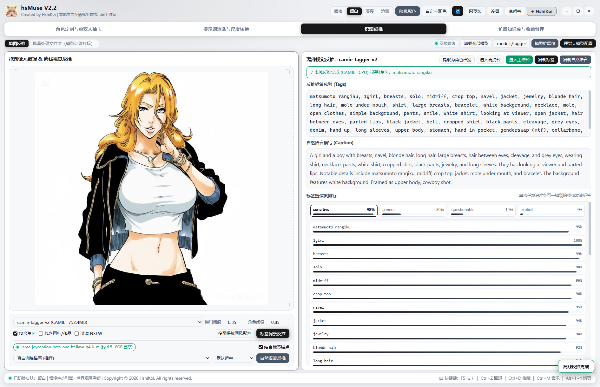
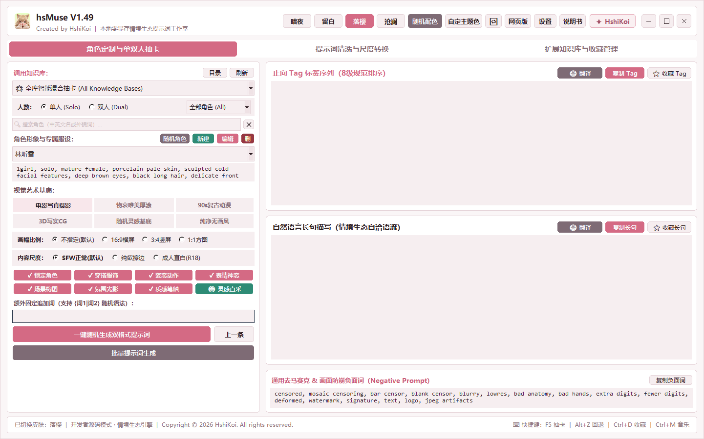
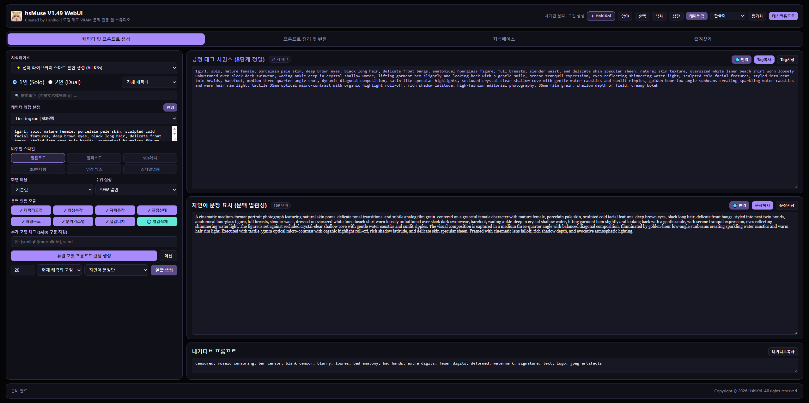
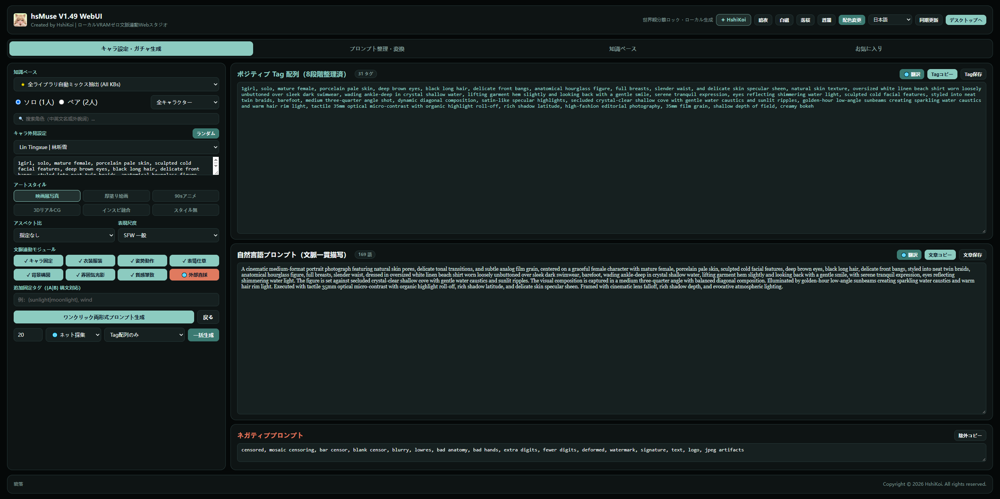
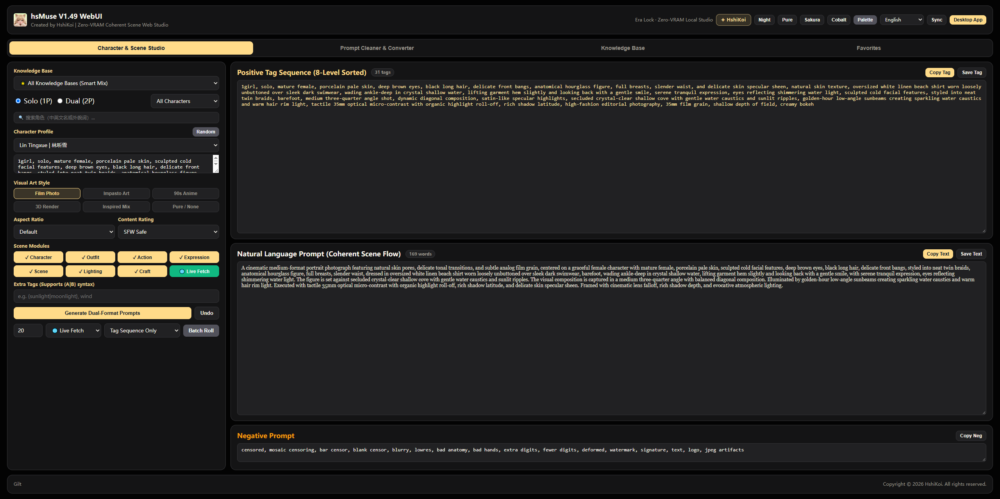
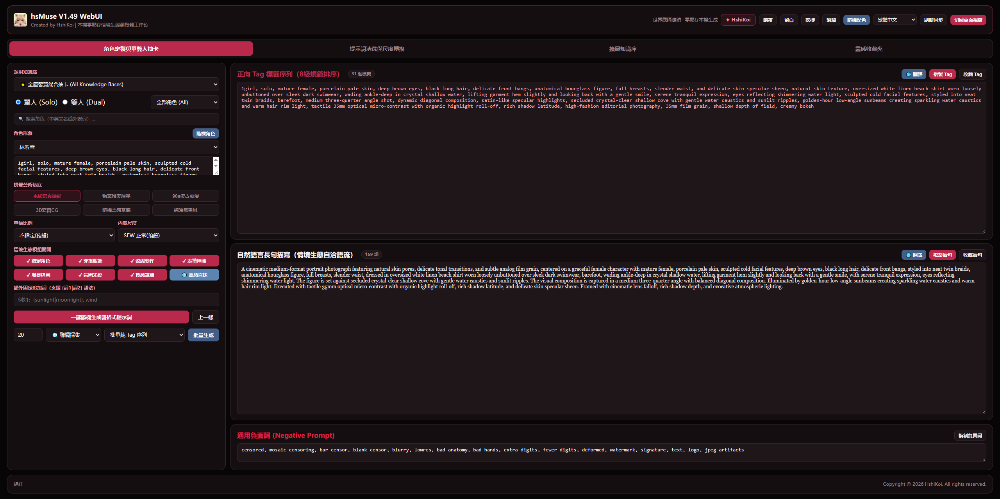

# ✦ hsMuse

**零显存、自进化的本地模块化视觉提示词工作台**  
**Zero-VRAM, Self-Growing Local Modular Visual Prompt Studio**

[简体中文](#-简体中文) • [English](#-english) • [📥 下载最新版 / Download](https://github.com/hshiKoi/hsMuse/releases/latest) • [📋 更新日志 / Changelog](CHANGELOG.md) • [⚖️ 使用条款 / Terms](TERMS.md)

---

## 🇨🇳 简体中文

> **【使用建议】** 推荐优先点击顶栏 **【网页版】**：大屏排版与滚动更流畅，数据与桌面端实时同步。

### 简介
**hsMuse** 是一款纯本地运行、零显存占用的 AI 绘画提示词引擎与资产管理工作台，深度适配 **ComfyUI / Flux / Krea 2 / SDXL**。一键同步输出 **「8 级规范排序 Tag 序列」** 与 **「电影级自然语言长句」**，通过四大世界观隔离与自进化词库/角色生态，告别跨时代串戏与提示词凌乱。

### 界面预览

| 暗夜 (Night) | 留白 (Pure) |
| :---: | :---: |
|  |  |

| 落樱 (Sakura) | 沧澜 (Cobalt) |
| :---: | :---: |
|  |  |

🎨 点击展开查看随机灵感配色预览（Random Themes）

 
<table>
  <tr>
    <td></td>
    <td></td>
  </tr>
  <tr>
    <td></td>
    <td></td>
  </tr>
</table>

### 核心功能亮点
- **可成长的动态角色库**：最高支持 500 位角色（首发内置 51 位人气角色与原创预设），支持自定义 OC、LoRA 触发词、专属服设、AI 提炼指令与联网自动去重收录；支持中英文实时搜索与单/双人空间隔离。
- **自进化模块化知识库**：独立 JSON 架构（支持扩展至 40 套、单栏 500 词条），首发内置 9 套高密度美学库与【灵感潮汐】池，支持 10 格可视化编辑、AI 一键造库导入及全库智能混搭。
- **四大世界观隔离锁 (Era Lock)**：严格隔离「现代时尚 / 东方仙侠 / 物哀哥特 / 自然水畔汤泉」生态，支持 `{A|B}` 随机通配符、角色原版服设锁定及单次最高 100 条批量去重输出。
- **多源并发灵感直采**：多线程并发抓取并自动剔除水印与画质废词，支持 SFW / 纯欲 / R18 分级，一键沉淀至本地灵感池。
- **批量清洗与尺度转换**：支持单次最高 200 行批量清洗，按需剥离 LoRA、权重括号、废词、人物外貌或基础服装（保留景别与神态词），一键转安全预览 / NSFW 并转自然语言。
- **多端协同与丰富周边**：桌面端 + 本地 WebUI 实时同步、1K~8K DPI 自适应、四引擎翻译（Youdao / MyMemory / Google / 自定义 AI）、GitHub Private Gist 私有云同步、本地 BGM 播放器与 5 国语言实时切换。

### 快速开始与快捷键
1. 前往 [**Releases 页面**](https://github.com/hshiKoi/hsMuse/releases/latest) 下载 `hsMuse_V1.49_Setup.exe` 双击安装（免管理员权限，支持自由选盘，卸载/更新完整保留个人数据）。
2. 打开后推荐点击顶栏 **【网页版】** 使用浏览器工作台。
3. 常用快捷键：`F5` 一键抽卡 ｜ `Alt + Z` 回退上一条 ｜ `Ctrl + D` 收藏 Tag ｜ `Ctrl + M` 切换背景音乐。
4. 想用 AI 扩展自定义词库或角色？请查看 [`templates/`](templates/) 目录中的范例与指令。

### 支持与交流
- **Patreon**：[patreon.com/c/hshiKoi](https://www.patreon.com/c/hshiKoi)
- **Ko-fi**：[ko-fi.com/hshikoi](https://ko-fi.com/hshikoi)
- **Civitai**：[civitai.red/user/HshiKoi](https://civitai.red/user/HshiKoi)
- **社群交流**：QQ 群 `978336169` ｜ 微信群 `hshi2026`
- **问题反馈**：欢迎直接提交 [GitHub Issues](https://github.com/hshiKoi/hsMuse/issues)

---

## 🌐 English

> **[Tip]** Click **[WebUI]** in the top bar for a smoother widescreen layout and scrolling—synced in real time with the desktop app.

### Overview
**hsMuse** is a 100% local, zero-VRAM visual prompt engine and creative asset studio built for **ComfyUI, Flux, Krea 2, and SDXL**. It generates **8-level sorted Tag sequences** and **cinematic natural language prose** simultaneously in one click, powered by a Four-Era Worldview Isolation Engine and a self-growing library of characters and modular knowledge bases.

### Key Highlights
- **Self-Growing Character Archive**: Manages up to 500 profiles (51 starter anime, game & original presets included). Supports custom OCs, LoRA triggers, signature outfits, AI trait extraction, live search, canonical-outfit locking, and spatially separated Solo/Dual framing.
- **Modular Knowledge Bases**: Portable JSON packs (up to 40 packs, 500 entries per slot), shipping with 9 high-density aesthetic packs + the dynamic *Muse Tide* pool. Visually edit across 10 slots, import AI-generated packs in seconds, and mix custom packs seamlessly.
- **4-Era Worldview Isolation (Era Lock)**: Separates *Modern*, *Eastern Fantasy (Xianxia)*, *Wabi-Sabi/Gothic*, and *Nature/Onsen* ecologies. Supports `{A|B}` wildcards and up to 100 unique batch prompts per run.
- **Multi-Source Live Fetch**: Concurrent rating-aware inspiration fetching (SFW / Sensual / R18) that strips watermarks/filler tags and archives curated traits back into your local pool.
- **Batch Prompt Cleaner & Converter**: Clean up to 200 lines per run—strip LoRAs, weights, quality filler, character traits, or base outfits (while preserving framing and expressions), convert between SFW/NSFW, and synthesize natural prose.
- **Full Desktop & WebUI Parity**: 1K–8K DPI scaling, 4 minimalist themes + 12 curated palettes, 4-engine translation (including custom OpenAI-compatible AI LLMs), zero-server private cloud sync (GitHub Private Gist), local BGM player, and instant 5-language UI switching.

### Quick Start & Shortcuts
1. Download `hsMuse_V1.49_Setup.exe` from the [**Releases Page**](https://github.com/hshiKoi/hsMuse/releases/latest) (no admin rights required; your personal data is preserved across updates).
2. Click **[WebUI]** in the top bar for the smoothest daily workflow.
3. Shortcuts: `F5` Roll ｜ `Alt + Z` Undo ｜ `Ctrl + D` Save Tag ｜ `Ctrl + M` Toggle Music.
4. Check [`templates/`](templates/) for sample JSON packs and AI builder prompts.

### Links & Support
- **Patreon**: [patreon.com/c/hshiKoi](https://www.patreon.com/c/hshiKoi)
- **Ko-fi**: [ko-fi.com/hshikoi](https://ko-fi.com/hshikoi)
- **Civitai**: [civitai.red/user/HshiKoi](https://civitai.red/user/HshiKoi)
- **Feedback**: [GitHub Issues](https://github.com/hshiKoi/hsMuse/issues)

---

Copyright © 2026 HshiKoi. All rights reserved.

