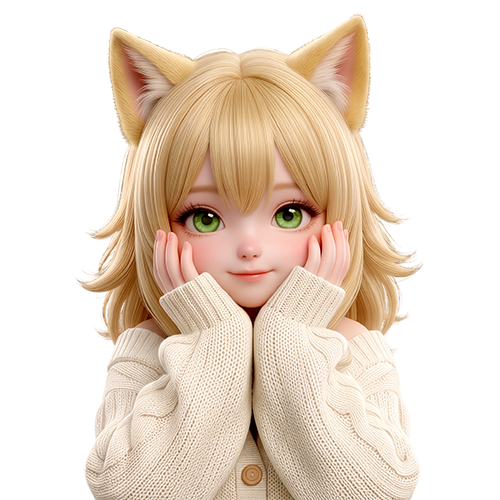
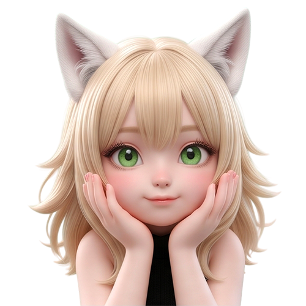
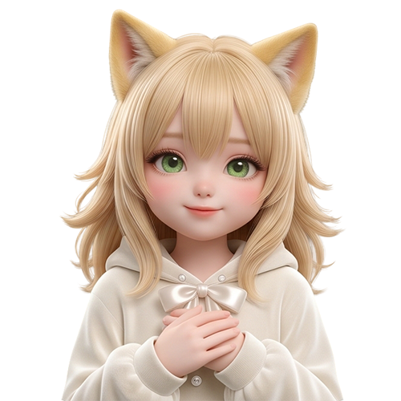

# ✦ Meet Hoshi ("Star")

**Original Character IP & Official Mascot of HshiKoi**

---

## Character Profile

| Attribute | Details |
| :--- | :--- |
| **Name** | **Hoshi** (ほし / 星 — meaning *"Star"*) |
| **Creator & Owner** | **HshiKoi** |
| **Species** | Wolf Girl *(unique wolf-girl identity, not a fox girl)* |
| **Signature Traits** | Golden hair, vibrant emerald-green eyes, fluffy wolf ears |
| **Personality** | Cute, confident, warm, and playfully expressive |
| **First Created** | January 12, 2025 — *Hs UltraHD CG IllGleam* (Civitai Refs: `50139192`, `50098301`) |
| **LoRA Model** | **Hoshi Anima LoRA** *(high consistency & controllability across scenes and outfits)* |

---

## Gallery

| Hoshi 01 | Hoshi 02 | Hoshi 03 |
| :---: | :---: | :---: |
|  |  |  |

---

## Story & Inspiration

**Hoshi** (ほし / 星, meaning *"Star"*) is the original character IP and representative avatar of **HshiKoi**.

She was first created on **January 12, 2025**, using the *Hs UltraHD CG IllGleam* version (Civitai reference works: `50139192`, `50098301`). Since then, Hoshi has served as HshiKoi's personal mascot and accompanied every step of the creative journey.

Designed as a wolf girl with golden hair, emerald-green eyes, and distinctive wolf ears, Hoshi brings together cuteness, natural confidence, and a playful spirit. While there are many beloved animal-eared characters—such as Ahri from *League of Legends*—Hoshi is **not** a fox girl; she is a wolf girl with her own distinct identity and charm.

The inspiration behind Hoshi comes from blending cross-cultural aesthetics: the natural confidence and poise admired in Western beauty paired with the delicate, endearing warmth of Asian character design.

---

## Hoshi Anima LoRA & Community Creations

The **Hoshi Anima LoRA** model was trained on Hoshi's daily-life portraits, diverse expressions, and varied outfits, giving creators strong character consistency and flexible control.

You are warmly welcome to use the model to explore new everyday scenes, fashion styles, expressions, and imaginative interpretations of Hoshi. **HshiKoi** simply asks that her core charm and wolf-girl identity be respected when creating derivative works.

Thank you to everyone who enjoys Hoshi and brings her to life in your own art—may this little wolf girl named *"Star"* spark endless inspiration for your creations!

---

[← Back to hsMuse Main Page](../README.md)

*Hoshi ("Star") is the original character IP of HshiKoi. Copyright © 2026 HshiKoi.*

